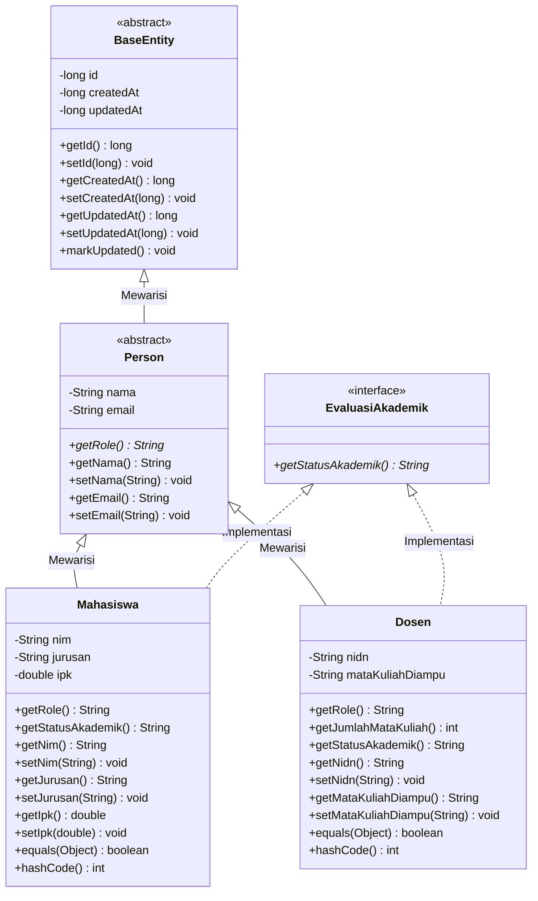

# MyKampus Lite

Aplikasi Android **offline** untuk manajemen dan pengelolaan data akademik Mahasiswa dan Dosen program studi berbasis arsitektur **MVVM (Model-View-ViewModel)**, **Room Persistence Library**, **LiveData**, dan penerapan prinsip **Object-Oriented Programming (OOP)** secara menyeluruh.

---

## 1. Fitur Utama

- **CRUD Lengkap Mahasiswa & Dosen:**
  - Tambah data baru dengan validasi otomatis di lapisan Model.
  - Tampil data dalam daftar interaktif dengan pembagian tab terpisah.
  - Edit data langsung melalui form dengan pengisian otomatis (*auto-fill*) dan pembaruan timestamp `updatedAt`.
  - Hapus data dengan dialog konfirmasi aman (*MaterialAlertDialog*).
- **Enkapsulasi Ketat (Encapsulation):**
  - Seluruh field entitas berstatus `private` 100%.
  - Validasi wajib di setter Model: Nama (tidak kosong, min 3 karakter), NIM (tepat 10 digit angka), IPK (rentang 0.0 – 4.0 inklusif), NIDN (tepat 10 digit angka), dan Mata Kuliah (tidak boleh kosong).
- **Pencegahan NIM Duplikat di Database (Indeks Unik):**
  - Menggunakan indeks unik SQLite pada Room `@Index(value = {"nim"}, unique = true)`.
  - Pelanggaran keunikan ditangani secara anggun oleh Repository tanpa membuat aplikasi mengalami force close / crash.
- **Evaluasi Akademik Polimorfik (Polymorphism):**
  - Implementasi interface `EvaluasiAkademik`:
    - **Mahasiswa:** `> 3.5` -> `"Cumlaude"`, `> 3.0` -> `"Memuaskan"`, `2.0 – 3.0` -> `"Normal"`, `< 2.0` -> `"Peringatan"`.
    - **Dosen:** `> 3 Mata Kuliah` -> `"Beban Lebih"`, `<= 3 Mata Kuliah` -> `"Normal"`.
- **Satu Multi-Type ListAdapter Terpadu (Bonus +10):**
  - Menggunakan `AkademikMultiTypeAdapter` yang mewarisi `ListAdapter<Person, RecyclerView.ViewHolder>`.
  - Mendukung dua tipe tampilan (`Mahasiswa` dan `Dosen`) menggunakan `getItemViewType()`.
  - Mengimplementasikan `equals()`, `hashCode()`, dan `DiffUtil.ItemCallback<Person>` untuk performa perenderan daftar yang optimal.
  - Memanggil `getStatusAkademik()` secara polimorfik tanpa duplikasi aturan percabangan status di adapter.
- **Pencarian Real-Time (Live Search):**
  - Fitur pencarian instan untuk Mahasiswa (berdasarkan Nama, NIM, atau Jurusan) dan Dosen (berdasarkan Nama, NIDN, atau Mata Kuliah).
- **Proteksi Draft Saat Rotasi Layar (Orientation-Safe):**
  - Menyimpan input form pengguna yang belum disimpan ke dalam `MahasiswaDraft` dan `DosenDraft` di ViewModel.
  - Menggunakan `SingleLiveEvent` untuk mencegah event Snackbar/Toast terpicu berulang kali saat layar diputar.
- **Penyimpanan Lokal Persisten & Threading Aman:**
  - Database Room tanpa pemanggilan `allowMainThreadQueries()`.
  - Seluruh operasi modifikasi database dieksekusi secara asinkron di latar belakang menggunakan `databaseWriteExecutor`.

---

## 2. Arsitektur dan Diagram

Aplikasi menerapkan pemisahan tanggung jawab (*Separation of Concerns*) sesuai arsitektur Google MVVM:

```mermaid
graph TD
    UI[MainActivity / Fragments\nMahasiswaFragment & DosenFragment] -->|Observasi LiveData\nKirim Event User| VM[AkademikViewModel]
    VM -->|Ketergantungan ke Interface\n(Dependency Inversion)| REPO[<<Interface>>\nAkademikRepository]
    REPO -.->|Implementasi Konkret| REPO_IMPL[MahasiswaRepository]
    REPO_IMPL -->|Query Background Executor| DAO[MahasiswaDao & DosenDao]
    DAO -->|SQLite Table| DB[(MyKampusDatabase\nRoom Database)]
    VM -->|Validasi Enkapsulasi| MODEL[Model: Mahasiswa & Dosen]
```

### Class Diagram Hierarki OOP



---

## 3. Lingkungan Pengembangan & Spesifikasi Versi

| Komponen / Dependensi | Versi Aktual yang Digunakan |
|---|---|
| Sistem Operasi | Windows 11 (64-bit) |
| Java Development Kit (JDK) | OpenJDK 21 (LTS) |
| Gradle | 9.3.1 |
| Android Gradle Plugin (AGP) | 9.1.1 |
| compileSdk / targetSdk | 36 |
| minSdk | 24 (Android 7.0 Nougat) |
| Room Persistence | 2.6.1 (`room-runtime`, `room-compiler`) |
| AndroidX Lifecycle | 2.8.7 (`lifecycle-viewmodel`, `lifecycle-livedata`) |
| ViewPager2 | 1.1.0 |
| RecyclerView | 1.4.0 |
| Google Material Components | 1.14.0 |
| JUnit | 4.13.2 |
| AndroidX Core Testing | 2.2.0 |

---

## 4. Cara Menjalankan Aplikasi

1. Clone repositori:
   ```bash
   git clone https://github.com/Michael-51/mykampuslite.git
   ```
2. Buka proyek melalui **Android Studio** (Ladybug / Meerkat / versi terbaru yang mendukung Gradle 9+).
3. Tunggu hingga proses **Gradle Sync** selesai secara otomatis.
4. Hubungkan emulator Android (API 24+) atau perangkat fisik melalui USB Debugging.
5. Klik menu **Run > Run 'app'** (`Shift + F10`) atau jalankan perintah Gradle berikut di terminal:
   ```bash
   ./gradlew assembleDebug
   ```
   File APK debug biner siap pakai akan dibuat pada:
   ```text
   app/build/outputs/apk/debug/app-debug.apk
   ```
6. Untuk menjalankan seluruh rangkaian unit test otomatis:
   ```bash
   ./gradlew testDebugUnitTest
   ```

---

## 5. Ringkasan Hasil Pengujian Aktual

Seluruh 32 unit test otomatis telah dijalankan dan **100% LULUS (32 tests passed, 0 failures, 0 errors)**:

| ID | Skenario Uji | Hasil Aktual | Status |
|---|---|---|---|
| **TC01** | Simpan Mahasiswa dengan seluruh data valid | Tersimpan ke database via executor background dan muncul di daftar via LiveData. | **LULUS** |
| **TC02** | Simpan nama kosong atau hanya spasi | Ditolak oleh `Person.setNama()`, melempar `IllegalArgumentException`. Data tidak masuk Room. | **LULUS** |
| **TC03** | Simpan nama panjang < 3 karakter | Ditolak oleh `Person.setNama()`. | **LULUS** |
| **TC04** | Simpan NIM berisi huruf | Ditolak oleh `Mahasiswa.setNim()` dengan regex `^\d{10}$`. | **LULUS** |
| **TC05** | Simpan NIM bukan tepat 10 digit (9/11 digit) | Ditolak oleh `Mahasiswa.setNim()`. Tepat 10 digit angka diterima. | **LULUS** |
| **TC06** | Simpan NIM duplikat yang sudah terdaftar | Ditolak oleh unique index Room. Exception ditangani aman oleh Repository tanpa crash. | **LULUS** |
| **TC07** | Simpan IPK di luar rentang (< 0.0 atau > 4.0) | Ditolak oleh `Mahasiswa.setIpk()`. | **LULUS** |
| **TC08** | Simpan IPK batas inklusif (0.0 dan 4.0) | Diterima dan tersimpan dengan presisi valid. | **LULUS** |
| **TC09** | Evaluasi status IPK Mahasiswa polimorfik | > 3.5 = Cumlaude, > 3.0 = Memuaskan, 2.0-3.0 = Normal, < 2.0 = Peringatan. | **LULUS** |
| **TC10** | Dosen mengampu <= 3 mata kuliah | Menghasilkan status `"Normal"`. | **LULUS** |
| **TC11** | Dosen mengampu > 3 mata kuliah | Menghasilkan status `"Beban Lebih"`. | **LULUS** |
| **TC12** | Edit data Mahasiswa | Perubahan tersimpan via DAO update, timestamp `updatedAt` diperbarui. | **LULUS** |
| **TC13** | Hapus data Mahasiswa | Konfirmasi dialog tampil, data terhapus dari Room, daftar terbarui. | **LULUS** |
| **TC14** | Operasi CRUD Dosen | Tambah, ubah, hapus, dan pencegahan duplikat NIDN unik berfungsi penuh. | **LULUS** |
| **TC15** | Putar layar setelah data tersimpan | Data persisten di Room SQLite dan LiveData tidak terduplikasi. | **LULUS** |
| **TC16** | Putar layar saat form berisi draft input | Draft tersimpan di `MahasiswaDraft` / `DosenDraft` ViewModel tanpa hilang. | **LULUS** |
| **TC17** | Thread operasi Room | Seluruh query tulis berjalan di `databaseWriteExecutor`, UI thread tidak terblokir. | **LULUS** |
| **TC18** | Adapter multi-tipe polimorfik | `AkademikMultiTypeAdapter` menangani dua tipe item memanggil `getStatusAkademik()`. | **LULUS** |
| **TC19** | Pembaruan reaktif LiveData | Komponen UI terbarui secara otomatis saat database mengalami mutasi. | **LULUS** |
| **TC20** | Konfigurasi final Room | Tidak ada pemanggilan `allowMainThreadQueries()` pada database produksi. | **LULUS** |

---

## 6. Jawaban Pertanyaan Refleksi

### 1. Apa yang terjadi jika constructor kosong di Entity Room dihapus?

Room memerlukan mekanisme instansiasi objek ketika membaca dan memetakan baris-baris hasil query SQLite menjadi instance objek Java. Pada entitas Java:
- Room mencari constructor yang cocok untuk membuat instance. Jika terdapat **constructor tanpa argumen (default constructor)**, Room akan membuat instance kosong terlebih dahulu, kemudian memanggil setter untuk setiap kolom field yang cocok.
- Jika constructor kosong dihapus dan hanya tersisa constructor berparameter yang tidak mencakup semua kolom (atau memiliki tipe parameter yang tidak dapat dipetakan secara ambigu oleh annotation processor), proses kompilasi Room akan **gagal dengan error `Cannot find a constructor for class ...`**.
- Walaupun constructor berparameter lengkap yang cocok dengan nama seluruh kolom dapat digunakan oleh Room, menyediakan constructor default dan menandai constructor programmatic tambahan dengan anotasi `@Ignore` adalah *best practice* yang menjamin kestabilan pemetaan field yang diwarisi dari superclass (`BaseEntity` dan `Person`).

### 2. Mengapa ViewModel tidak boleh meng-import `android.widget.TextView`? Hubungkan dengan prinsip Abstraction.

ViewModel dirancang berdasarkan prinsip **Separation of Concerns** dan **Abstraction**:
- **Pemisahan Lapisan Logika & Presentasi:** Tugas ViewModel adalah mengelola *state*, validasi logika bisnis, dan orkestrasi data. ViewModel tidak boleh mengetahui detail implementasi tampilan (*View*). Jika ViewModel mengimpor `TextView`, ViewModel menjadi terikat erat (*tightly coupled*) pada komponen platform Android UI tertentu.
- **Pencegahan Memory Leak:** `TextView` menyimpan referensi kuat (*strong reference*) ke `Context` Activity. Karena siklus hidup (*lifecycle*) ViewModel bertahan melintasi rotasi layar (sementara Activity dihancurkan dan dibuat ulang), menyimpan referensi `TextView` di dalam ViewModel akan menyebabkan kebocoran memori (*memory leak*).
- **Pengujian Unit Tanpa Dependensi Framework:** Dengan prinsip Abstraction, ViewModel hanya mengekspos data melalui `LiveData<T>`. ViewModel dapat diuji secara terisolasi di JVM lokal menggunakan `InstantTaskExecutorRule` tanpa membutuhkan emulator atau runtime Android framework.

### 3. Berikan satu contoh nyata di studi kasus ini di mana Polymorphism menghemat baris kode.

Contoh paling nyata berada pada **`AkademikMultiTypeAdapter`**:
- Mahasiswa dan Dosen memiliki rumus status akademik yang berbeda: Mahasiswa dihitung berdasarkan nilai IPK, sedangkan Dosen dihitung berdasarkan jumlah mata kuliah yang diampu.
- Tanpa polymorphism, adapter atau view holder harus melakukan pemeriksaan tipe manual (`if (item instanceof Mahasiswa) { ... } else if (item instanceof Dosen) { ... }`) dan menduplikasi seluruh percabangan aturan evaluasi nilai IPK dan jumlah beban mengajar di dalam UI.
- Dengan memanfaatkan antarmuka polimorfik `EvaluasiAkademik`:
  ```java
  if (item instanceof EvaluasiAkademik) {
      String status = ((EvaluasiAkademik) item).getStatusAkademik();
      holder.binding.tvStatusAkademik.setText(status);
  }
  ```
  Adapter hanya perlu memanggil satu method kontrak `getStatusAkademik()`. Objek `Mahasiswa` dan `Dosen` secara mandiri mengeksekusi logika spesifik masing-masing. Kode adapter menjadi sangat ringkas, bersih, dapat digunakan bersama (*reusable*), dan mematuhi prinsip *Open/Closed Principle* (jika ada entitas baru seperti `Tendik`, adapter tidak perlu diubah sama sekali).
